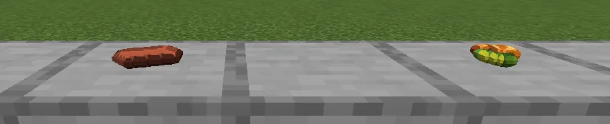

**Heft** draws every flat item as a solid one, made from the picture your resource packs already
give it. In your hand, dropped on the ground and set down with [Set It Down](/wiki/set-it-down), an
item stops being a thin cut-out and takes the shape of what it is: an apple round, a loaf of bread
domed on a flat bottom, a cookie a thin disc, a steak a slab, an ingot a bar, coal a lump, a gem cut
to a ridge, dust a little heap. Everything else that was drawn flat (other mods' items included) is
given depth. Every item keeps its vanilla size.

## What changes

- **In the world, solid:** held in either hand, in first and third person, dropped on the ground,
  set down, and worn on your head.
- **In slots and frames, as before:** your inventory, the hotbar, every chest and menu, and item
  frames show the flat picture, exactly as your resource pack draws it.
- **Flowers, saplings, grass and coral** in your hand look as they do when planted: two crossed
  leaves instead of one.
- **Left alone:** armour, and anything a resource pack or another mod already draws in 3D, such as
  Fresh Food's food and Refined Tools' tools. The few of Fresh Food's that don't look like what they
  are (mutton, the pork chops, bread and potatoes) are drawn by Heft instead.

## With Set It Down

What you put down lies on its flat side. Ingots, books and small cuts of meat (pork chops, bacon,
fish slices) pile up; raw ore, gems and dust heap together; a whole joint (a steak, a leg of mutton,
a whole chicken or fish) is one to a spot.

## Settings

Heft is only on your side: you can join without it, and turning it off changes nothing for anyone
else. In the mod list, Heft's **Config** button has:

| Setting | What it does |
|---|---|
| `enabled` | draw flat items as solid ones (off: everything as before) |
| `flatClasses` | kinds of item to leave flat, such as `ingot` or `spawn_egg` |
| `denylist` | items to leave flat, by id (`minecraft:filled_map`) or a whole mod (`somemod:*`) |

Changes take effect when you reload resources (**F3 + T**).

## If something looks wrong

Hold the item and type `/heft inspect`: it says how the item is drawn, what kind of thing Heft
takes it for, and by whom it is drawn (Heft, another mod, or flat). Report it, naming the item.
