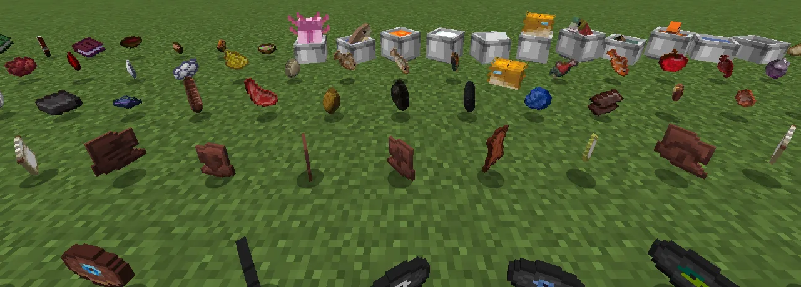
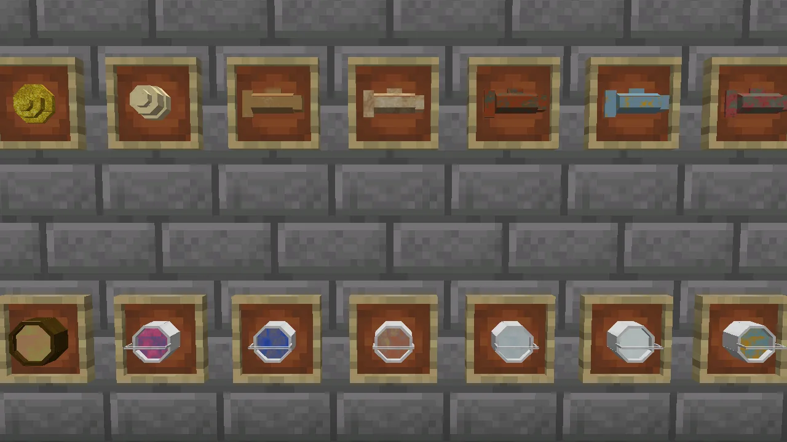
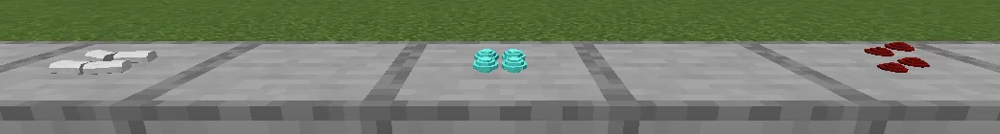

**Heft** draws every flat item as a solid one. Ingots, gems, dusts, coal, food, paper, books,
signs, arrows, dyes, discs and the rest stop being thin cut-outs and become real little models:
in your inventory, in your hand, dropped on the ground, in item frames, and set down with
[Set It Down](/wiki/set-it-down). Every item of a kind has one shape (every ingot is the same
ingot, every gem the same gem), with its own detailed textures that shaders light properly.

## What changes

- **Things with a shape of their own:** metals and minerals (ingots, nuggets, raw ore, coal, gems,
  shards, dust, Create's brass and zinc and the pack's other metals), rods and bones, paper, maps
  and hides, books, signs, arrows, and food: meat, bread, potatoes, Farmer's Delight's dishes and
  more.
- **Everything else** that was drawn flat (other mods' items included) is drawn thick: the same
  picture, given depth and sharpened. A bow still draws back.
- **Flowers, saplings, grass and coral** in your hand look as they do when planted: two crossed
  leaves instead of one.
- **Left alone:** armour, and anything a resource pack or another mod already draws in 3D, such
  as Fresh Food's food and Refined Tools' tools, or draws its own way, such as the spawn eggs. The few of Fresh Food's that don't look like what they are (mutton, the
  pork chops, bread and potatoes) are drawn by Heft instead.

## With Set It Down

Set It Down sizes what you put down by its model, so a Heft ingot lies down as a solid bar and
piles and heaps look like what they are. Small cuts of meat (pork chops, bacon, fish slices) pile
up or heap together; a whole joint (a steak, a leg of mutton, a whole chicken or fish) is one to a
spot.

## Settings

Heft is only on your side: you can join without it, and turning it off changes nothing for anyone
else. In the mod list, Heft's **Config** button has:

| Setting | What it does |
|---|---|
| `enabled` | draw flat items as solid ones (off: everything as before) |
| `flatClasses` | kinds of shape to leave flat, such as `ingot` |
| `tierB.enabled` | draw everything else thick |
| `tierB.denylist` | items to leave flat, by id (`minecraft:filled_map`) or a whole mod (`somemod:*`) |

Changes take effect when you reload resources (**F3 + T**).

## If something looks wrong

Hold the item and type `/heft inspect`: it says how the item is drawn and by whom (Heft, another
mod, or flat). An item drawn in purple and black is a Heft model missing its texture: report
it, naming the item.
